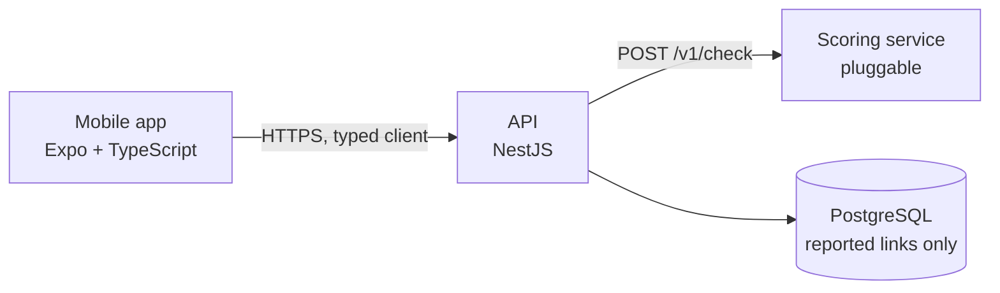

# How it is built

IsItFishy has four parts: a mobile app, an API, a PostgreSQL database and a scoring
service. The app only ever talks to the API. The API asks the scoring service for a result
and keeps a small amount of data about reported links.

## Mobile app

`apps/mobile` is an [Expo](https://expo.dev/) / React Native app written in TypeScript. It
has one main screen: a text box, a QR scanner and a check button. Text shared to the app
from another app lands in the same box. The result screen shows the risk band, a one-line
summary and the reasons, grouped as evidence, warning signs and what lowers the risk.

Recent checks are stored on the phone only. The app has no accounts, no analytics and no
advertising. It follows the system language and theme, and both can be changed in the app.

See [Mobile app](mobile.md) for running and building it.

## API

`apps/api` is a [NestJS](https://nestjs.com/) service. It:

- validates input and passes checks to the scoring service, returning only the public part
  of the answer to the app;
- stores links that users report as scams, or as wrongly flagged, without their query
  string, and lists the most reported domains of the last week;
- serves a small review page for reports, protected by a token;
- limits requests per client address;
- describes itself with an OpenAPI document.

The database is reached through [Prisma](https://www.prisma.io/); migrations live in
`apps/api/prisma/migrations` and run when the container starts.

See [API](api.md) for the endpoints.

## Typed client

`packages/api-client` is generated from the API's OpenAPI document with
`openapi-typescript`. The app imports its types, so a change to an endpoint that the app
does not follow fails type checking. CI regenerates the document and the client and fails
when the committed copy is out of date.

## Database

PostgreSQL holds reports and their review status. It never holds the text a user checked.
In the Helm chart a CronJob dumps the database every day and keeps the last seven dumps.

## Scoring service

The API does not decide anything itself. It sends the input to a scoring service over one
HTTP endpoint and expects a fixed JSON shape back. Anything that speaks that contract can be
plugged in: the [stub scorer](scoring-contract.md#the-stub-scorer) in this repository, a
scorer of your own, or the private one behind the public app.

See [Scoring service contract](scoring-contract.md).

## Deployment

Locally, Docker Compose runs PostgreSQL, the API and the stub scorer. On a server, the Helm
chart in `deploy/helm/isitfishy` runs the same services on Kubernetes (tested on single-node
k3s behind Traefik). See [Self-hosting](self-hosting.md).
