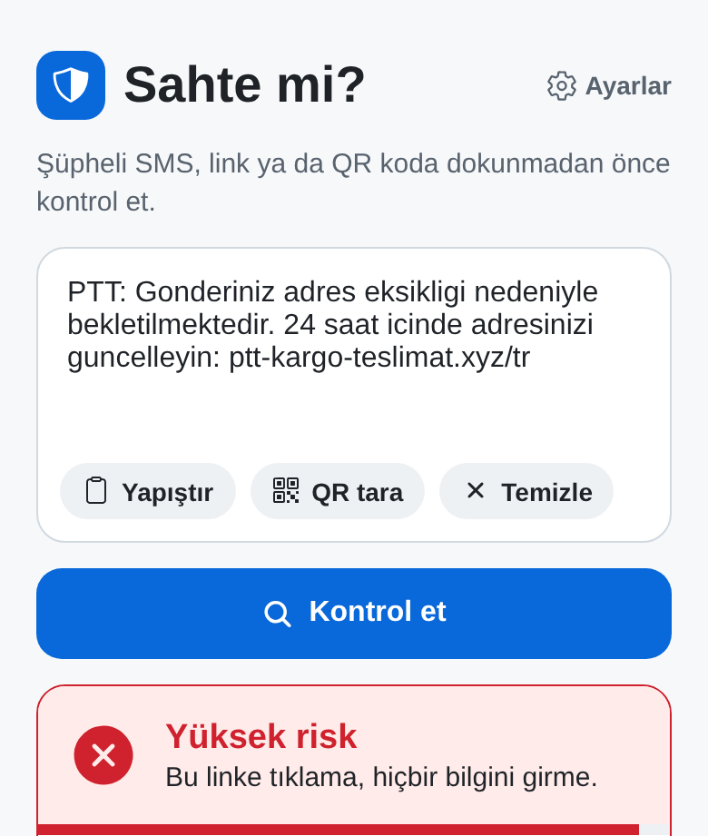
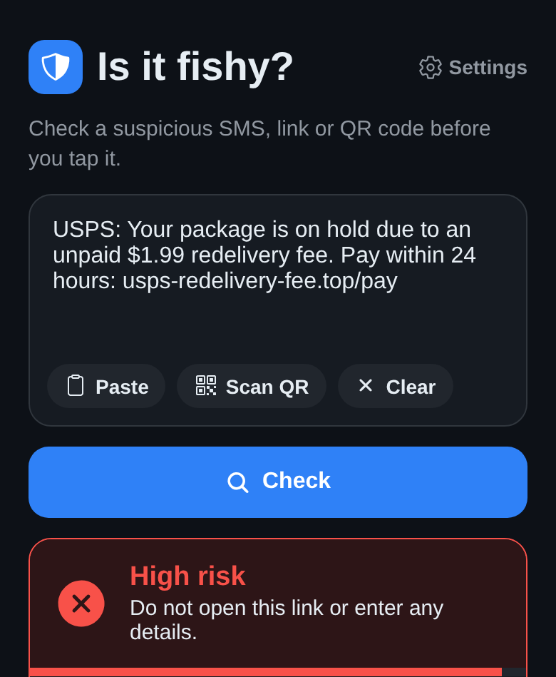
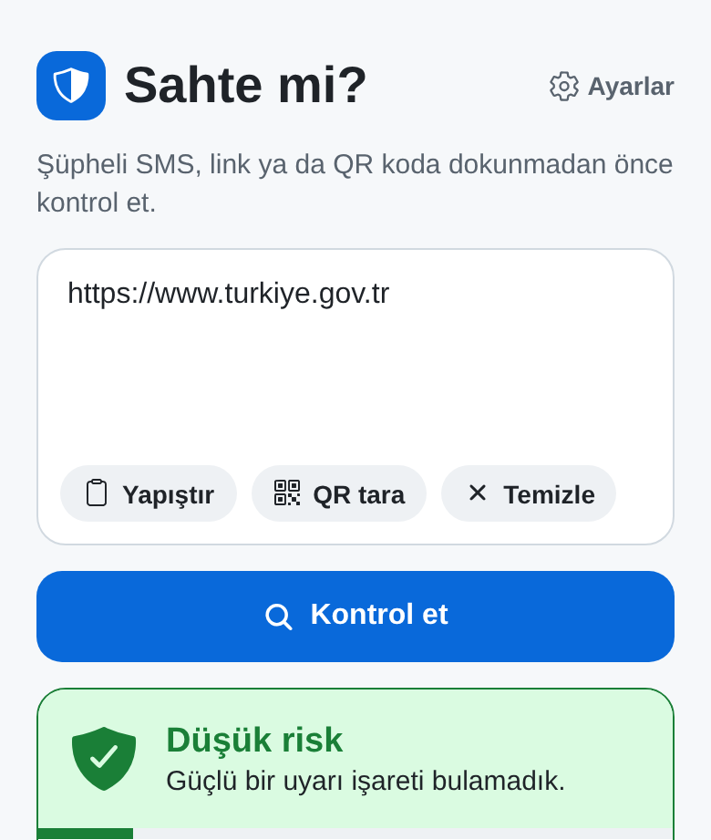

# IsItFishy

Scam checker for links, QR codes and SMS messages.

Paste a message, share a link or scan a QR code, and IsItFishy answers with a risk band,
**low**, **medium** or **high**, and the reasons behind it in plain language. The app speaks
Turkish, English, German, Spanish, French and Italian.

Screenshots show the hosted service. The stub scorer in this repository returns demo results
instead.

Low means no strong warning signs were found, not that a link is safe. When nothing speaks
for a link either, the app says **Not verified** instead of calling it low risk.

!!! note "Status"
    Early development. Not yet published in any app store.

## What is in this repository

The mobile app, the API, the typed API client, the deployment files and these docs. The
service that scores a message is a separate component behind a small HTTP contract. The
repository ships a [stub scorer](scoring-contract.md#the-stub-scorer) so everything runs
end to end; the scorer behind the public app is private and deliberately not documented,
so scammers cannot tune their sites against it.

- **[How it is built](architecture.md)**: the app, the API, the database and where scoring plugs in.
- **[Self-hosting](self-hosting.md)**: Docker Compose for a laptop, a Helm chart for a server.
- **[Mobile app](mobile.md)**: run it with Expo, build it for Android, test it with Maestro.
- **[API](api.md)**: the endpoints and the OpenAPI document.
- **[Scoring service contract](scoring-contract.md)**: plug in a scorer of your own.
- **[Privacy](privacy.md)**: what is kept, and what is not.

## Highlights

- Typed TypeScript client generated from the API's OpenAPI document, with a CI check for drift
- Maestro end-to-end flows on an Android emulator in CI
- Helm chart for k3s: non-root pods, probes, resource limits, daily database backups
- Per-client rate limiting and a token-guarded review queue for reports
- Reports stored without query strings; message text never written anywhere
- Six languages, system, light and dark themes, large text mode

## License

[MIT](https://github.com/isitfishy/isitfishy/blob/main/LICENSE)
